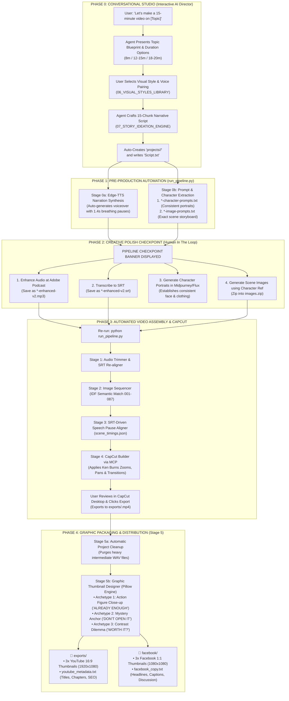

# 🎬 Luna: Autonomous Story Video & Social Distribution Pipeline

[](https://www.python.org/)
[](https://nodejs.org/)
[](./capcut-mcp-server)
[](LICENSE)
[]()

**Luna** is an end-to-end, reproducible production engine designed for high-retention philosophical video essays and social media storytelling (in the spirit of *Pursuit of Wonder*, *Aperture*, and *Studio Ghibli*). 

It automates the full journey from **conversational concept ideation** to a fully assembled, motion-choreographed **CapCut Desktop timeline**, followed by **Canva-standard multi-platform thumbnail and social packaging**.

---

## 🚀 Key Capabilities

* **🧠 Conversational Story Director**: Bridges ideation to production. Generates 15-chunk narrative scripts engineered with the *Retention Anchor* methodology and *Zoom-In / Zoom-Out* cognitive pacing.
* **🎨 Curated Visual Styles Library**: 5 production-tested visual aesthetics (Princess Kaguya Ink & Watercolor, Studio Ghibli Gouache, 35mm Nostalgic Film, Nordic Editorial Cutout, and Rembrandt Chiaroscuro Oil).
* **🗣️ Automated Voiceover & Breath Synthesis**: Microsoft Edge Neural TTS integration with calibrated `-8%` storytelling cadence and $1.4\text{s}$ chunk breathing pauses.
* **🎭 Character Consistency Engine**: Automatically extracts character profiles and generates standalone reference portrait prompts (`*-character-prompts.txt`) before scene generation.
* **⏱️ SRT-Driven Speech Pause Alignment**: Mathematically aligns cuts strictly to natural speech pauses rather than arbitrary video durations.
* **✂️ Native CapCut Builder via MCP**: Constructs native CapCut Desktop drafts with non-overlapping audio, cubic Ken Burns motion (slow zooms, diagonal pan drifts), and atmospheric blur/vignette effects.
* **🖼️ Canva-Standard Graphic Thumbnail Designer**: Replaces raw scene copies with high-CTR 3-archetype graphic thumbnails (Action Figure Emotion, Mystery Anchor, Contrast Dilemma) for **YouTube (16:9 - 1920x1080)** and **Facebook (1:1 - 1080x1080)** with multi-directional drop shadow typography.

---

## 🏗️ End-to-End Pipeline Architecture



---

## 📁 Repository Layout

```text
├── capcut-mcp-server/             # Model Context Protocol (MCP) server for CapCut Desktop
│   ├── src/                       # TypeScript MCP tool definitions & schema
│   ├── dist/                      # Compiled Node.js runtime entrypoint
│   └── package.json
│
├── master_pipeline/               # Core pipeline scripts, templates, and specifications
│   ├── docs/                      # Comprehensive technical manuals & guides
│   │   ├── 00_ENVIRONMENT_AND_SETUP.md
│   │   ├── 00_PRE_PRODUCTION_AND_HANDOFF.md
│   │   ├── 01_AUDIO_ENGINEERING_RULEBOOK.md
│   │   ├── 02_IMAGE_MATCHING_AND_NAMING.md
│   │   ├── 03_SCENE_TIMING_ALIGNMENT.md
│   │   ├── 03_CAPCUT_INTERNALS_SPEC.md
│   │   ├── 04_KEN_BURNS_AND_EFFECTS.md
│   │   ├── 05_YOUTUBE_PACKAGING_AND_CLEANUP.md
│   │   ├── 06_VISUAL_STYLES_LIBRARY.md
│   │   ├── 07_STORY_IDEATION_AND_SCRIPTWRITING_ENGINE.md
│   │   ├── 08_THUMBNAIL_DESIGN_AND_PACKAGING_SPEC.md
│   │   └── NEW_PC_SETUP_PROMPT.md  # 1-click setup prompt for new workstations
│   │
│   ├── scripts/                   # Production-tested Python & Node automation scripts
│   │   ├── run_pipeline.py        # Central orchestrator & checkpoint manager
│   │   ├── speech_synthesizer.py  # Stage 0a: Edge-TTS speech generation
│   │   ├── prompt_generator.py    # Stage 0b: 87-scene & character prompt generator
│   │   ├── audio_trimmer.py       # Stage 1: Smart silence trimmer & SRT re-aligner
│   │   ├── image_processor.py     # Stage 2: IDF semantic image sequence matcher
│   │   ├── scene_aligner.py       # Stage 3: SRT speech pause timing synchronizer
│   │   ├── capcut_builder.js      # Stage 4: CapCut timeline & motion compiler
│   │   ├── youtube_packager.py    # Stage 5: Final cleanup & metadata generator
│   │   ├── thumbnail_designer.py  # Stage 5b: Canva-standard graphic thumbnail designer
│   │   └── create_lightweight_zip.py # Portable project packager
│   │
│   └── templates/                 # Pristine CapCut draft templates
│
└── projects/                      # Story project workspaces (e.g. The Locksmith's Spare Key)
```

---

## ⚡ Quickstart Guide

### 1. Prerequisites (Windows)
* Python 3.12+
* Node.js 18+ LTS
* Gyan FFmpeg & FFprobe
* CapCut Desktop (Windows)

Install dependencies via PowerShell:
```powershell
# Python packages
pip install pydub edge-tts pillow requests

# Build CapCut MCP Server
cd capcut-mcp-server
npm install
npm run build
cd ..
```

### 2. Configure CapCut MCP Server
Add the server entry to your MCP client config (`mcp_config.json`):
```json
{
  "mcpServers": {
    "capcut": {
      "command": "node",
      "args": [
        "D:\\Himu\\Luna\\capcut-mcp-server\\dist\\index.js"
      ]
    }
  }
}
```

### 3. Running a Story Project

1. Create a project folder with your `Script.txt`:
   ```powershell
   New-Item -ItemType Directory -Path "projects/My_New_Story" -Force
   # Place Script.txt inside projects/My_New_Story/
   ```

2. Trigger the Pre-Production Automations:
   ```powershell
   python master_pipeline/scripts/run_pipeline.py --project-dir "projects/My_New_Story"
   ```
   * The pipeline automatically synthesizes your narration audio (`.mp3`), extracts character portrait prompts, and breaks the story into scene storyboard prompts.

3. Enhance audio at [Adobe Podcast](https://podcast.adobe.com/enhance), transcribe to `.srt`, generate character and scene images, and drop them in as `images.zip`.

4. Re-run the pipeline to build your CapCut project:
   ```powershell
   python master_pipeline/scripts/run_pipeline.py --project-dir "projects/My_New_Story"
   ```

5. Open CapCut Desktop, export the final `.mp4` into `exports/`, and inspect your ready-to-publish thumbnails and post copy in `facebook/` and `exports/`.

---

## 📖 Complete Documentation Index

For in-depth specifications, consult the manuals in [`master_pipeline/docs/`](./master_pipeline/docs/):
* [00: Environment & Setup Guide](./master_pipeline/docs/00_ENVIRONMENT_AND_SETUP.md)
* [00: Pre-Production & Handoff Protocol](./master_pipeline/docs/00_PRE_PRODUCTION_AND_HANDOFF.md)
* [01: Audio Engineering & SRT Remapping](./master_pipeline/docs/01_AUDIO_ENGINEERING_RULEBOOK.md)
* [02: Image Matching & Semantic Sequencing](./master_pipeline/docs/02_IMAGE_MATCHING_AND_NAMING.md)
* [03: SRT Speech Pause Synchronization](./master_pipeline/docs/03_SCENE_TIMING_ALIGNMENT.md)
* [03: CapCut Internals & Draft Architecture](./master_pipeline/docs/03_CAPCUT_INTERNALS_SPEC.md)
* [04: Ken Burns Motion & Visual Effects](./master_pipeline/docs/04_KEN_BURNS_AND_EFFECTS.md)
* [05: YouTube Packaging & SEO Architecture](./master_pipeline/docs/05_YOUTUBE_PACKAGING_AND_CLEANUP.md)
* [06: Visual Design Styles Library](./master_pipeline/docs/06_VISUAL_STYLES_LIBRARY.md)
* [07: Story Ideation & Scriptwriting Engine](./master_pipeline/docs/07_STORY_IDEATION_AND_SCRIPTWRITING_ENGINE.md)
* [08: Thumbnail Design & Social Packaging Spec](./master_pipeline/docs/08_THUMBNAIL_DESIGN_AND_PACKAGING_SPEC.md)
* [New PC 1-Click Setup Prompt](./master_pipeline/docs/NEW_PC_SETUP_PROMPT.md)

---

## 📄 License
This project is licensed under the MIT License — see the [LICENSE](LICENSE) file for details.
