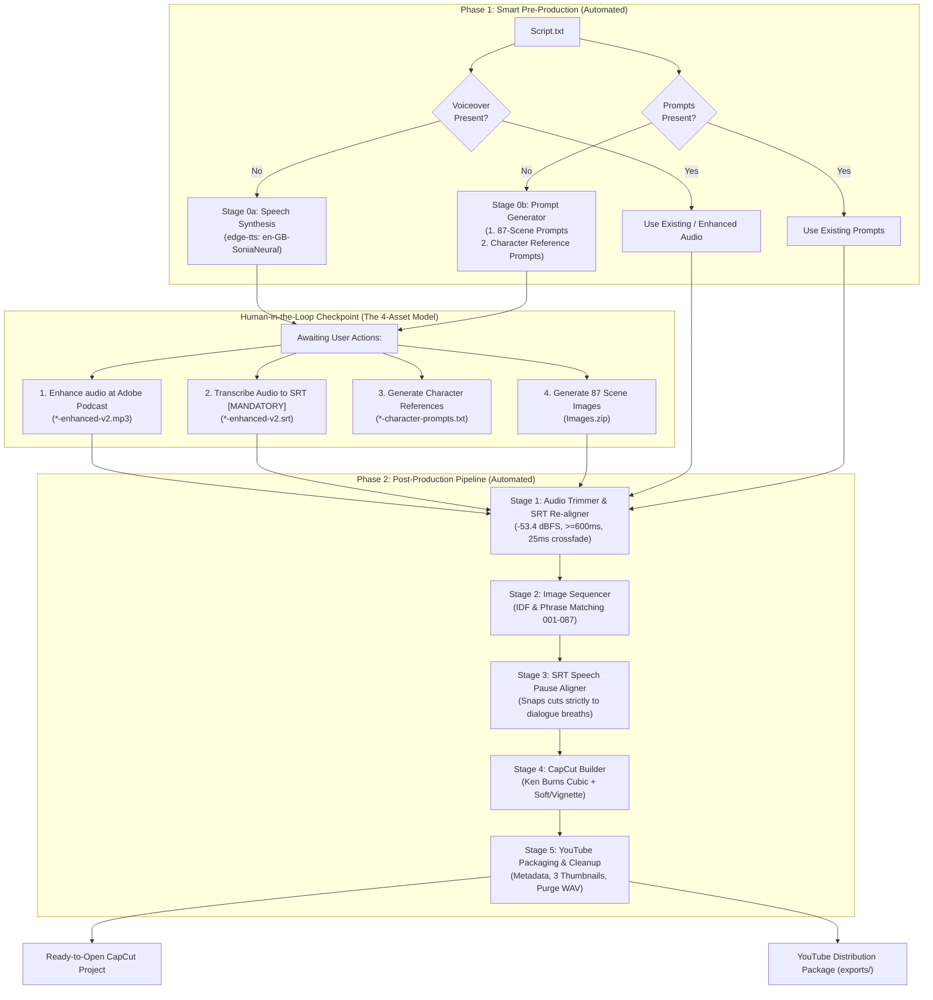

# Master Story Video Production Pipeline & Knowledge Base

An end-to-end, reproducible framework for turning raw story assets (prompts, audio voiceover, and generated images) into broadcast-ready, fully synchronized **CapCut Desktop projects** with professional audio pacing, Ken Burns motion choreography, and atmospheric visual effects.

---

## 1. Pipeline Architecture



---

## 2. Directory Structure

```
d:\Himu\Luna\master_pipeline\
├── README.md                           # Master documentation & quickstart
├── docs/                               # Engineering specifications & rulebooks
│   ├── 00_ENVIRONMENT_AND_SETUP.md     # System requirements, dependencies & doctor check
│   ├── 00_PRE_PRODUCTION_AND_HANDOFF.md # Smart pre-production & user handoff protocol
│   ├── 01_AUDIO_ENGINEERING_RULEBOOK.md # Pacing, padding, DSP standards & SRT re-mapping
│   ├── 02_IMAGE_MATCHING_AND_NAMING.md # Semantic fuzzy matching & sequencing
│   ├── 03_SCENE_TIMING_ALIGNMENT.md    # SRT-driven speech pause & timing sync
│   ├── 03_CAPCUT_INTERNALS_SPEC.md     # Reverse-engineered CapCut v5+ architecture
│   ├── 04_KEN_BURNS_AND_EFFECTS.md     # Motion keyframing & effects guide
│   └── 05_YOUTUBE_PACKAGING_AND_CLEANUP.md # Post-production cleanup & YouTube SEO
├── templates/                          # Pristine project templates
│   └── clean_project/                  # Isolated CapCut draft template
└── scripts/                            # Production-ready automation scripts
    ├── speech_synthesizer.py           # Stage 0a: edge-tts voiceover synthesizer
    ├── prompt_generator.py             # Stage 0b: 87-scene Kaguya prompt & character generator
    ├── audio_trimmer.py                # Stage 1: audio trimming & SRT re-aligner
    ├── image_processor.py              # Stage 2: image matching & sequencer (IDF + phrase match)
    ├── scene_aligner.py                # Stage 3: SRT speech pause beat aligner
    ├── capcut_builder.js               # Stage 4: CapCut project generator & sync
    ├── youtube_packager.py             # Stage 5: cleanup & YouTube packager
    └── run_pipeline.py                 # Master smart orchestrator (Phase 1 & Phase 2)
```

---

## 3. The Adaptive Input Contract

You can start a project with **as little as just `Script.txt`**:

| Initial Files Provided | What the Pipeline Automatically Does |
| :--- | :--- |
| **Only `Script.txt`** | 1. Generates voiceover via `edge-tts` (`<project>.mp3`).<br/>2. Generates 87 Princess Kaguya scene prompts AND character reference prompts.<br/>3. Displays handoff action banner for Adobe Podcast, mandatory SRT transcription, character generation, & `Images.zip`. |
| **`Script.txt` + `prompts.txt`** | Skips prompt generation; generates audio (if missing); asks for audio enhancement, mandatory SRT, and images. |
| **Audio + Mandatory SRT + `Images.zip`** | Skips Phase 1 entirely; executes Stages 1–5 end-to-end to build the fully synced CapCut draft! |

---

## 4. Quickstart: One-Command Execution

Drop your project folder in `d:\Himu\Luna\projects\<project_name>\` and run:

```bash
python d:\Himu\Luna\master_pipeline\scripts\run_pipeline.py --project-dir "d:\Himu\Luna\projects\<project_name>"
```

- **If images/enhanced audio/SRT are missing**: It auto-generates voiceover, scene prompts, and character reference prompts, presents the user handoff banner, and waits.
- **When all assets are in place**: It auto-detects `*-enhanced*.mp3`, `*.srt`, and `Images.zip`, trims the audio, matches all 87 scenes, snaps cuts strictly to spoken dialogue breath pauses, builds the CapCut project, and packages the YouTube deliverables.

---

## 5. Modular Step-by-Step Execution

If you wish to execute each step independently:

### Step 1: Trim Audio
```bash
python d:\Himu\Luna\master_pipeline\scripts\audio_trimmer.py \
  --input "voiceover.mp3" \
  --output-wav "trimmed.wav" \
  --output-mp3 "trimmed.mp3"
```

### Step 2: Match and Sequence Images
```bash
python d:\Himu\Luna\master_pipeline\scripts\image_processor.py \
  --prompts "prompts.txt" \
  --input "images.zip" \
  --output "sequenced_images"
```

### Step 3: Align Scene Durations
```bash
python d:\Himu\Luna\master_pipeline\scripts\scene_aligner.py \
  --audio "trimmed.wav" \
  --num-scenes 87 \
  --output "scene_timings.json"
```

### Step 4: Build CapCut Project
```bash
node d:\Himu\Luna\master_pipeline\scripts\capcut_builder.js \
  --project-name "My Story Project" \
  --audio "trimmed.wav" \
  --images-dir "sequenced_images" \
  --timings "scene_timings.json"
```

---

## 6. Key Learnings & Engineering Principles

1. **Audio Trimming**: Never use raw digital silence gates. Always protect consonant attack (180ms) and decay (300ms), crossfade room tone, and apply tiered pauses (380ms comma, 650ms sentence, 1000ms scene break).
2. **CapCut v5+ Integrity**: `draft_content.json.id` must match `Timelines/<UUID>` and `Timelines/project.json.main_timeline_id`. Root `draft_content.json` and `template-2.tmp` must be byte-identical to the timeline folder copy.
3. **Motion Keyframing**: Use `curveType: "Cubic"` with Bézier handles to avoid linear robotic cuts. Alternate push-in, pull-out, and drift-pan.
4. **Visual Effects**: Built-in `Soft` (intensity 0.35) and `Vignette` (intensity 0.30) elevate still digital illustrations into storybook cinematic animation.
