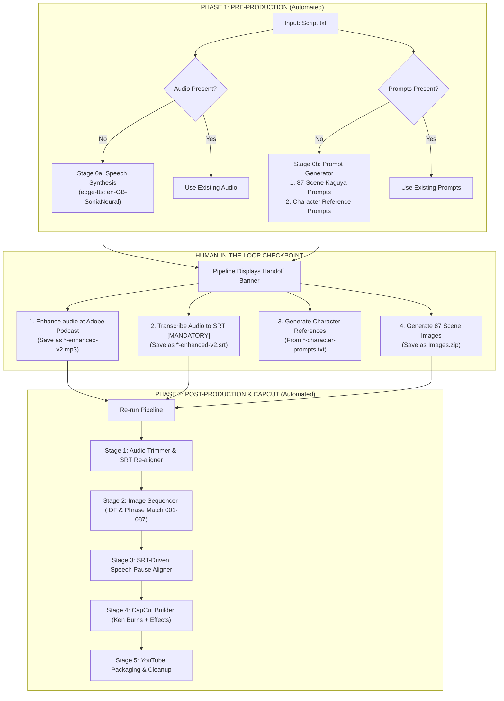

# Pre-Production Automation & User Handoff Protocol

This guide outlines the smart, adaptive workflow of the Story Video Production Pipeline. The pipeline now functions in **two interconnected phases** with a seamless **human-in-the-loop checkpoint**:



---

## 1. Phase 1: Smart Pre-Production Auto-Generation

When setting up a new story project under `projects/<Project Name>/`, you can simply drop a `Script.txt` file and run:

```powershell
python "D:\Himu\Luna\master_pipeline\scripts\run_pipeline.py" --project-dir "D:\Himu\Luna\projects\<Project Name>"
```

The orchestrator dynamically inspects the folder and handles missing assets:

### A. Stage 0a: Automated Speech Synthesis (`speech_synthesizer.py`)
- **Condition**: Executed automatically if no `.mp3` or `.wav` audio is detected in the project folder.
- **Engine**: Microsoft Edge Neural TTS via `edge-tts`.
- **Default Voice**: `en-GB-SoniaNeural` (Gentle, soothing British storytelling tone).
- **Cadence**: `-8%` speech rate with $1.4\text{s}$ breathing pauses between narrative chunks.
- **Output**: `<Project Name>.mp3` at 320 kbps.

### B. Stage 0b: 87-Scene Kaguya Prompt & Character Generator (`prompt_generator.py`)
- **Condition**: Executed automatically if no `*prompt*.txt` file is detected.
- **Outputs**:
  1. `<project-slug>-kaguya-image-prompts.txt` containing **exactly 87 scene prompts**.
  2. `<project-slug>-character-prompts.txt` containing **standalone character portrait generation prompts**.
- **Features**:
  - Automatically parses script chunks and distributes scenes evenly across the narrative.
  - Detects characters and tokenizes references (e.g. `otto_man`, `nina_daughter`, `marta_girl`, `paul_neighbor`).
  - Generates specialized character reference portrait prompts so the creator can generate character reference images first, establishing visual character consistency before rendering all 87 scenes.
  - Appends the full *The Tale of Princess Kaguya* watercolor and ink wash aesthetic suffix.

---

## 2. The Human-in-the-Loop Checkpoint (The 4-Asset Model)

Once Phase 1 finishes (or whenever enhanced audio, mandatory SRT subtitles, or `Images.zip` are not yet present), the pipeline pauses and displays an action banner:

```
======================================================================
>> PRE-PRODUCTION COMPLETED (AWAITING USER ASSETS)
======================================================================
Project: <Project Name>

1. Voiceover Audio: <Project Name>.mp3
   [ACTION]: Enhance this audio at Adobe Podcast (https://podcast.adobe.com/enhance)
             Save the enhanced file as '<Project Name>-enhanced-v2.mp3' in:
             D:\Himu\Luna\projects\<Project Name>

2. Subtitle / Transcript File (.srt) [MANDATORY]:
   [ACTION]: Transcribe the enhanced audio (via TurboScribe, Whisper, or Adobe)
             Save the file as '<Project Name>-enhanced-v2.srt' in:
             D:\Himu\Luna\projects\<Project Name>
             * MANDATORY: Guarantees 100% word-for-word timeline sync with the VO!

3. Character Generation Prompts: <project-slug>-character-prompts.txt
   [ACTION]: Generate character portrait reference images first for visual consistency!

4. Scene Image Prompts: <project-slug>-kaguya-image-prompts.txt
   [ACTION]: Generate the 87 scene images using the character references, and place them as
             'Images.zip' in:
             D:\Himu\Luna\projects\<Project Name>

When all assets are placed in the folder, run:
  python run_pipeline.py --project-dir "D:\Himu\Luna\projects\<Project Name>"
======================================================================
```

> [!IMPORTANT]
> **Why the SRT file is MANDATORY:**
> Without an `.srt` subtitle file, the scene aligner previously had to approximate dialogue progress uniformly. Variations in dialogue density (e.g., some scenes having 1 sentence while others had 3) led to drift of up to 30–50 seconds across the timeline.
>
> Providing the `.srt` file ensures:
> 1. Scene transitions lock strictly to spoken breath pauses between subtitle entries.
> 2. What the voiceover is narrating matches the visual scene currently shown on screen with 0 drift.
> 3. Stage 1 automatically re-aligns subtitle timestamps across silence trimming.

> [!TIP]
> **Why Character Prompts come first:**
> Before rendering 87 scene frames, generating the character portraits from `<project-slug>-character-prompts.txt` gives you fixed visual anchor images (face, clothing, colors, age). Using these as image-to-image or character style references in Midjourney/Flux/Bing ensures that characters remain identical across the entire video.

---

## 3. Phase 2: Post-Production Pipeline Execution

When you place the enhanced audio (`*-enhanced*.mp3`), the transcript (`*.srt`), and the image archive (`Images.zip`) in the project folder, re-running the same command automatically triggers **Phase 2**:

1. **Step Skipping**:
   - Audio generation is **skipped** (auto-detects `*-enhanced-v2.mp3`).
   - Prompt generation is **skipped** (uses existing prompts).
2. **Stage 1 (Audio Trimming & Subtitle Re-alignment)**: Compacts dead-air silences with $25\text{ms}$ crossfades and mathematically re-maps all subtitle timestamps to `trimmed_voiceover.srt`.
3. **Stage 2 (Image Matching)**: Performs IDF token-weighted and bigram phrase matching of all 87 scenes into `001_` through `087_`.
4. **Stage 3 (SRT Speech Aligner)**: Snaps visual cut boundaries to the narrator's natural speech pauses between subtitle lines.
5. **Stage 4 (CapCut Builder)**: Assembles the CapCut Desktop project with Ken Burns Cubic easing and atmospheric visual filters.
6. **Stage 5 (YouTube Packager)**: Generates `youtube_metadata.txt`, packages 3 thumbnails, and purges intermediate WAV files.
