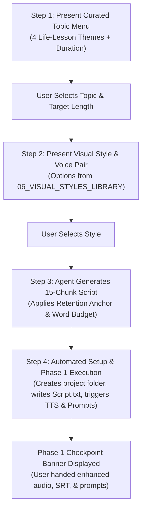

# Story Ideation & Scriptwriting Engine: Conversational Video Essay Blueprint

This engine is the **ideation and writing foundation** (Stage -1) of the Luna Production Pipeline. It codifies high-retention video essay storytelling (inspired by *Pursuit of Wonder*, *Aperture*, James Clear, and Morgan Housel) and equips the AI Agent to conduct a structured, minimal, and fully automated conversation with the user to take a video from vague idea to finished CapCut timeline.

---

## 1. The Conversational Director Protocol

When the user initiates production (e.g., *"Make a 15-minute video"* or *"Let's start a new story"*), the agent does **not** improvise randomly. Instead, it follows this standardized 4-step interactive flow:



### The Interactive Dialog Script (How the Agent Responds to the User)

```text
Director Agent:
"Welcome to Luna Production. Let's create your next video essay. 
Here are 4 curated high-retention life-lesson topics ready for production:

1. [TIME MANAGEMENT] The Clockmaker's Unspent Hour
   — Theme: Why saving time never makes us peaceful; the illusion of modern productivity.
2. [MONEY & PATIENCE] The Quiet Mason's Ledger
   — Theme: The Morgan Housel paradox: wealth is what you don't spend; the invisible power of compound waiting.
3. [GRIEF & LETTING GO] The Archivist's Lost Box
   — Theme: Why we cling to broken things and the precise moment holding on becomes heavier than letting go.
4. [SOLITUDE & CRAFT] The Joiner Who Removed His Clock
   — Theme: Why true mastery requires boredom and silence in a world addicted to dopamine.

Which topic would you like to pursue? (Or provide your own custom theme).
Also, please confirm your target length:
• Option A: 8–10 Minutes (~1,200 words | ~87 scenes)
• Option B: 12–15 Minutes (~2,200 words | ~140 scenes)
• Option C: 18–20 Minutes (~2,900 words | ~180 scenes)"
```

Once the topic and duration are selected, the agent asks for the visual style:

```text
Director Agent:
"Which visual aesthetic and narration tone would you like to pair with this story?
• STYLE-01: Princess Kaguya Hand-Drawn Watercolor & Ink Wash (Default, Melancholy, Sonia Neural)
• STYLE-02: Studio Ghibli Hand-Painted Gouache Animation (Warm, Nostalgic, Ryan Neural)
• STYLE-03: 35mm Nostalgic Cinematic Film Realism (Kodak Portra, Gritty, Christopher Neural)
• STYLE-04: Nordic Editorial Gouache & Cutout (Modern folk art, Thoughtful, Sonia Neural)
• STYLE-05: Rembrandt Chiaroscuro Painterly Oil (Solemn, Candlelit, Guy Neural)
Or would you like to reuse the style from our previous project?"
```

Once confirmed, the agent **automatically**:
1. Creates `projects/<Project Name>/`
2. Generates and writes `Script.txt` (structured in 15 distinct chunks with bracketed timestamps).
3. Executes `python master_pipeline/scripts/run_pipeline.py --project-dir "projects/<Project Name>"`
4. Pauses at the **Phase 1 Human Checkpoint** and gives the user their exact next steps.

---

## 2. The Psychology of High-Retention Video Essays

High-retention video essays on platforms like YouTube succeed because of specific cognitive dynamics:

### A. The "Retention Anchor" Framework (Writing Backwards)
Never write chronologically from start to finish without a locked emotional destination. 
1. **Determine the Final Revelation**: What is the single counter-intuitive truth the viewer must feel in their chest at minute 15? (e.g., *“The key wasn't made to open a locked door. It was made to remind him that some doors are meant to remain closed.”*)
2. **Work Backwards**: Every preceding chunk is engineered to lay an invisible brick toward that payoff. If a sentence does not set up or intensify this final realization, cut it.

### B. Curiosity Loops & The "Problem Stack"
- **No Cold Intros**: Never begin with *"In this video, we will explore..."* or a channel splash screen.
- **The Micro-Mystery**: Open with a physical, sensory anomaly that seems simple but implies a profound emotional question. (e.g., *“Every morning at precisely 6:15, an old man named Arthur moves a brass key exactly three inches across his workbench. He has done this for forty years, yet the lock it belongs to was destroyed in 1984.”*)
- **Dangling Carrots**: Resolve one minor curiosity loop only after opening an existential one. The viewer stays because clicking away leaves an itch unscratched.

### C. The "Zoom-In / Zoom-Out" Rhythm
Pacing fatigue occurs when an essay stays too long in abstract philosophy (boring) or too long in mundane plot (trivial). High retention alternates like breathing:
- **Zoom-In (Concrete Sensory Detail)**: The sound of a rusted iron spring, the smell of damp cedar chips, tea cooling on a laminate table.
- **Zoom-Out (Universal Philosophical Synthesis)**: What this specific object reveals about how all human beings handle regret, time, or mortality.

### D. Spoken-Word Cadence Calibration
- Narrated prose must be written for the **ear**, not the eye.
- **Delivery Rate**: 140–155 words per minute (at `-8%` speed on neural TTS).
- **Breath Gaps**: Mark narrative breaks explicitly. The listener requires $1.2\text{s}$ to $1.5\text{s}$ of silence after a heavy realization to digest its meaning.

---

## 3. The 15-Chunk Structural Architecture

Every video script produced by this engine adheres to this 15-chunk narrative spine, calibrated across three duration tiers:

| Chunk | Beat Title | Psychological Purpose | Retention Mechanism | Visual Focus |
| :---: | :--- | :--- | :--- | :--- |
| **01** | **The Cold Paradox** | Disorient expectations; establish immediate mystery. | Open Curiosity Loop #1. No channel intros. | Extreme macro close-up of a small physical object. |
| **02** | **The Grounded Routine** | Ground the character in tactile reality and daily rhythm. | Relatable sensory immersion. | Wide environmental scene; domestic/work routine. |
| **03** | **The Unspoken Friction** | Reveal that the peaceful routine conceals an unresolved tension. | Subconscious discomfort; unanswered question. | A lingering look; an object left untouched. |
| **04** | **The Catalyst / Anomaly** | An outside force or unexpected event disturbs the daily balance. | Narrative disruption. | A visitor arrives, a letter is received, an item breaks. |
| **05** | **The First Resistance** | The protagonist attempts to solve the disruption with old methods. | Escalating stakes; predictable tactics fail. | Frantic or obstinate action; physical effort. |
| **06** | **The Micro-Failure** | The old coping mechanism breaks down; tension surfaces openly. | Peak emotional vulnerability. | Solitary reflection in fading evening light. |
| **07** | **Zoom-Out I: The Mirror** | First philosophical shift. Connect protagonist's dilemma to the viewer. | Universalization: "This is not just about him; it is about you." | Abstract wide landscape or atmospheric empty room. |
| **08** | **The Forgotten Memory** | Flashback or recollection of how the unresolved wound originated. | Backstory payoff for Curiosity Loop #1. | Soft-focus memory, younger hands, warmer palette. |
| **09** | **The Counter-Argument** | A secondary character or internal doubt challenges the core belief. | Intellectual friction; cognitive dissonance. | Intimate dialogue; two figures framed in profile. |
| **10** | **The Deepening Valley** | The darkest emotional point; realizing the lost time cannot be regained. | Heavy emotional resonance; the crisis point. | Late night rain, single candle/lamp, heavy shadows. |
| **11** | **The Pivot / Quiet Discovery** | Not an explosive triumph, but a small, silent shift in perception. | The turning of the psychological lock. | Morning light breaking across dust motes; quiet breath. |
| **12** | **The Deliberate Action** | The protagonist performs a new, unfamiliar gesture of acceptance. | Tangible resolution of the physical plot. | Hands performing an uncharacteristic, gentle task. |
| **13** | **Zoom-Out II: The Life Lesson** | The grand philosophical synthesis. Unpack the core thesis. | Direct value delivery; the notebook takeaway. | Timeless human landscapes; cycles of nature. |
| **14** | **The Bittersweet Return** | Life resumes, but everything is fundamentally recalibrated. | Catharsis and emotional grounding. | Return to the opening room, now lit with softer light. |
| **15** | **The Lingering Echo** | A single final resonant sentence that echoes after the screen fades. | Lasting retention anchor; urge to reflect or rewatch. | Lingering still frame of the opening object, transformed. |

---

## 4. Word Budget & Scene Timing Calculator

| Video Duration | Total Word Count | Target Scene Count | Words per Scene | Pacing Rate |
| :--- | :--- | :--- | :--- | :--- |
| **8–10 Minutes** | $1,150 - 1,250$ words | 87 scenes | $13 - 15$ words / scene | ~142 WPM (-8%) |
| **12–15 Minutes** | $1,750 - 2,250$ words | 135–150 scenes | $14 - 16$ words / scene | ~145 WPM (-8%) |
| **18–20 Minutes** | $2,700 - 3,100$ words | 180–200 scenes | $14 - 16$ words / scene | ~148 WPM (-8%) |

> [!IMPORTANT]
> **Chunk Formatting Rule**: In `Script.txt`, separate each chunk with a clean header:
> `[CHUNK 01: THE COLD PARADOX]`
> This guarantees that `speech_synthesizer.py` parses distinct sections and inserts automatic $1.4\text{s}$ pause intervals, preventing audio fatigue.

---

## 5. Master Story Blueprints (Ready to Produce)

### Blueprint A: Time Management — *The Watchmaker’s Third Hand*
- **Core Life Lesson**: We do not suffer from a lack of time; we suffer from the delusion that time can be collected and stored. True peace begins when you stop optimizing every second and allow time to pass without claiming ownership of it.
- **Characters**: 
  - `edward_watchmaker`: Age 74, meticulous horologist, trembling hands, magnifying loupe, linen apron.
  - `maya_apprentice`: Age 22, modern engineering student, impatient, uses digital stopwatches.
- **Sensory Anchors**: Ticking escapement gears, brass filings on green felt, an uncoiled mainspring that refuses to fit into its barrel, tea gone cold on a zinc bench.
- **Key Payoff**: *"A clock does not measure what you have accomplished; it only measures what you have allowed to slip past while you were calculating your next move."*

### Blueprint B: Money & Patience — *The Quiet Mason’s Ledger*
- **Core Life Lesson** (Morgan Housel Style): True wealth is what you do not see. It is the option you didn't exercise, the argument you didn't have, and the money that remains quiet in the dark rather than performing for strangers.
- **Characters**:
  - `julian_mason`: Age 68, stone wall builder, weathered knuckles, patched woolen vest, unassuming.
  - `marcus_broker`: Age 36, city nephew, clean fingernails, sleek watch, obsessed with velocity and returns.
- **Sensory Anchors**: Chiseled granite chips, lime mortar drying under fingernails, an old ledger with only three numbers written per year, a dry-stone wall standing without cement.
- **Key Payoff**: *"The wall that stands for two hundred years is never the one built the fastest. It is the one where every stone was given time to settle into the dirt before the next weight was laid upon it."*

### Blueprint C: Grief & Possessions — *The Archivist’s Lost Box*
- **Core Life Lesson**: We keep old items not because they have utility, but because we believe that letting go of the object is equivalent to abandoning the person who touched it.
- **Characters**:
  - `frank_locksmith` (or `arthur_archivist`): Age 71, retired city records clerk, reading glasses, quiet dignity.
  - `clara_daughter`: Age 42, practical, helping clean out the family attic, anxious to finish.
- **Sensory Anchors**: Yellowed parcel string, rusted padlock with no key, smell of old paper and dust motes in sunbeams, an unopened tin of butterscotch candies from 1998.
- **Key Payoff**: *"The weight was never in the brass of the key or the wood of the chest. The weight was in the promise that someday, if we waited long enough, the past might give back what it took."*

### Blueprint D: Solitude & Modern Distraction — *The Joiner Who Removed His Clock*
- **Core Life Lesson**: The modern mind treats silence as an empty room that must be furnished immediately with noise. But depth of thought only occurs when the room is left completely bare.
- **Characters**:
  - `tobias_carpenter`: Age 65, woodworker, works with hand planes, refuses modern power tools.
  - `lucas_neighbor`: Age 29, software developer working remotely, permanently wired into earbuds.
- **Sensory Anchors**: Curling white pine shavings that smell like honey, hand-sharpened Japanese waterstones, the complete silence of a workshop at 4 PM when the dust settles.
- **Key Payoff**: *"When you take away the noise that tells you what you are supposed to want, you are left with the terrifying privilege of finding out who you actually are."*

---

## 6. End-to-End Automated Project Kickoff

When the user says *"Run it"*, the agent executes this exact sequence:

```powershell
# 1. Create Project Directory
New-Item -ItemType Directory -Path "D:\Himu\Luna\projects\The_Watchmakers_Unspent_Hour" -Force

# 2. Write Script.txt (formatted in 15 chunks) into the directory

# 3. Trigger Phase 1 Pre-Production Automations
python "D:\Himu\Luna\master_pipeline\scripts\run_pipeline.py" --project-dir "D:\Himu\Luna\projects\The_Watchmakers_Unspent_Hour"
```

The pipeline automatically:
1. Generates the full 320 kbps narration audio file with breathing pauses.
2. Extracts canonical character profiles and generates `*-character-prompts.txt`.
3. Breaks down the 15 chunks into 87 scene prompts matching the chosen visual style and outputs `*-kaguya-image-prompts.txt`.
4. Halts gracefully at the **Phase 1 Handoff Banner**, presenting the user with the 4 assets needed for Phase 2.
