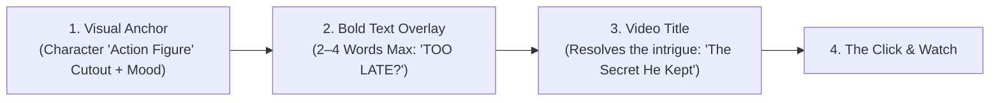

# High-CTR Thumbnail Design & Social Packaging Specification

This document codifies the **Canva-Style Graphic Design Methodology** for YouTube and Facebook thumbnails. In the Luna Production Pipeline, thumbnails are **never** treated as raw video screengrabs or copied scene illustrations. Thumbnails are standalone graphic design assets engineered to capture attention in the first 400 milliseconds of scrolling.

---

## 1. The Core Philosophy: "Thumbnail-First" Packaging

On YouTube and Facebook, the visual hierarchy of user discovery follows a strict 3-step sequence:
1. **0.0 - 0.4 seconds**: The viewer's eye catches the **Thumbnail Image** (Emotional expression, color contrast, character silhouette).
2. **0.4 - 0.8 seconds**: The viewer reads the **Thumbnail Text Overlay** (2–4 words maximum, provocative or incomplete thought).
3. **0.8 - 1.5 seconds**: The viewer reads the **Post / Video Title** to complete the mystery, then clicks.



> [!IMPORTANT]
> **The Golden Rule of Synergy:**
> The Title and Description must be **inspired by the Thumbnail**, not the other way around. 
> **Never repeat the video title on the thumbnail!** 
> *Bad:* Title: "The Locksmith's Spare Key" | Thumbnail Text: "The Locksmith's Spare Key" (Redundant, zero curiosity).
> *Good:* Thumbnail Text: "DON'T OPEN IT." | Title: "The Secret Behind the Locksmith's Spare Key" | Description Hook: "For forty years, Frank kept a key to a door he was forbidden to unlock. Yesterday, he finally used it."

---

## 2. The 3 Master Thumbnail Archetypes

For every story or video post, the pipeline designs **three distinct conceptual variants** across both **YouTube (16:9 - 1920x1080)** and **Facebook (1:1 Square - 1080x1080 / 4:5 Portrait - 1080x1350)** formats:

### Archetype A: The "Action Figure" Emotional Close-Up
* **Visual Composition**:
  - A prominent, isolated character cutout ("the action figure") positioned on the left or right third of the frame.
  - High emotional intensity: intense gaze, furrowed brow, tears, weary stoicism, or quiet shock.
  - Rim lighting (soft amber or cool blue edge) to separate the character from the background.
  - Background is subtly darkened, desaturated, or given an intentional $12\text{px}$ Gaussian depth blur.
* **Text Formula**: Emotional confrontation ($2 - 3$ words).
  - Examples: `"ALREADY ENOUGH"`, `"WHY DID HE STAY?"`, `"TOO TIRED TO CARE"`.
* **Platform Placement**: Text placed in the top-left or upper-third to avoid YouTube's bottom-right video duration badge.

### Archetype B: The "Mystery Anchor" (Curiosity Object)
* **Visual Composition**:
  - Macro dramatic close-up of a symbolic story object (e.g. an antique glowing brass key, an unbroken wax seal, an old unspent ledger, a ticking balance wheel).
  - Dramatic chiaroscuro lighting: single-point warm candlelight cutting through deep, moody shadows.
  - Tactile, tangible textures that feel touchable through the screen.
* **Text Formula**: The forbidden secret ($2 - 4$ words).
  - Examples: `"NEVER SPEND IT"`, `"WHAT WAS INSIDE?"`, `"THE UNUSED KEY"`.

### Archetype C: The High-Contrast Dilemma (The Juxtaposition)
* **Visual Composition**:
  - A split composition or visual conflict showing two incompatible realities:
    - *Old vs. New*: Weathered craftsman hands holding fine hand-tools vs. modern digital screens.
    - *Inside vs. Outside*: Warm, peaceful, quiet workshop interior vs. cold, torrential, hurried city rain outside the window.
* **Text Formula**: The uncomfortable question ($2 - 3$ words).
  - Examples: `"WORTH IT?"`, `"STOP HURRYING"`, `"THE WRONG RACE"`.

---

## 3. Graphic Design & Typography Rules (The Canva Standard)

When designing thumbnails, adhere to these professional graphic design principles:

### A. Typography Hierarchy
1. **Font Weight**: Ultra-heavy, bold sans-serif or geometric display typeface (e.g., Anton, Montserrat Black, Impact, Bebas Neue, League Spartan). Thin or delicate script fonts are strictly forbidden on thumbnails because they turn invisible on mobile screens.
2. **Text Legibility**:
   - Every word must be readable when scaled down to $150\text{px}$ wide (the size of a thumbnail on a mobile feed).
   - Text color: Pure White (`#FFFFFF`) or Punchy Warm Amber/Yellow (`#FFD166` / `#F4A261`).
   - Contrast Enhancement: Drop shadow with high opacity ($75\%$, blur $10\text{px}$, offset $4\text{px}$) or a dark semi-transparent highlight pill box behind text.
3. **Word Limit**: **Maximum 4 words**. Ideal is 2 to 3 words.

### B. YouTube Safe Zones & Badge Avoidance
* **Bottom-Right Corner**: Keep the bottom-right $25\%$ of the thumbnail completely free of critical visual details, faces, and text overlays. The YouTube timestamp badge (`14:22`) covers this area entirely.
* **Top & Left Thirds**: The safest, highest-engagement zone for primary typography and hero action figures.

### C. Facebook & Social Folder Structure
For social media distribution, thumbnails are exported into dedicated folders inside each project:

```text
projects/<Project_Name>/
├── exports/
│   ├── thumbnail_01_character_emotion_16x9.jpg   (YouTube 1920x1080)
│   ├── thumbnail_02_mystery_object_16x9.jpg      (YouTube 1920x1080)
│   ├── thumbnail_03_contrast_dilemma_16x9.jpg    (YouTube 1920x1080)
│   └── youtube_metadata.txt
└── facebook/
    ├── fb_post_01_character_emotion_square.jpg   (Facebook 1080x1080)
    ├── fb_post_02_mystery_object_square.jpg      (Facebook 1080x1080)
    ├── fb_post_03_contrast_dilemma_square.jpg    (Facebook 1080x1080)
    └── facebook_copy.txt                         (Tailored social copy & hooks)
```

---

## 4. Title, Description & Thumbnail Triad Examples

### Story: *The Man Who Refused to Be Important*
* **Thumbnail Concept 1 (The Action Figure)**:
  - *Visual*: Weathered old bicycle mechanic Arthur looking out a rain-soaked workshop window, holding a warm mug of tea. Soft warm amber rim light, cool gray city street blurred in the background.
  - *Thumbnail Text*: **"ALREADY ENOUGH."**
  - *YouTube Title*: **The Quiet Power of Being Unimportant | A Story About Refusing to Hustle**
  - *Description Hook*: *"At 4:15 PM every day, Arthur closes his workshop and walks away from money. In a world shouting at you to optimize every second, this is what happens when you choose to stay ordinary."*

* **Thumbnail Concept 2 (The Mystery Anchor)**:
  - *Visual*: Extreme macro close-up of a vintage brass spoke wrench tightening a single wheel spoke, with an unopened letter from a corporate buyout firm sitting in the shadows.
  - *Thumbnail Text*: **"HE SAID NO."**
  - *YouTube Title*: **The Man Who Refused to Scale | An Atmospheric Tale of Craft & Peace**

* **Thumbnail Concept 3 (The Contrast Dilemma)**:
  - *Visual*: Split contrast: Julian's modern ultra-light carbon bike frame next to Arthur's hand-carved wooden workbench.
  - *Thumbnail Text*: **"THE WRONG RACE"**
  - *YouTube Title*: **Why Saving Time Never Makes Us Peaceful**
